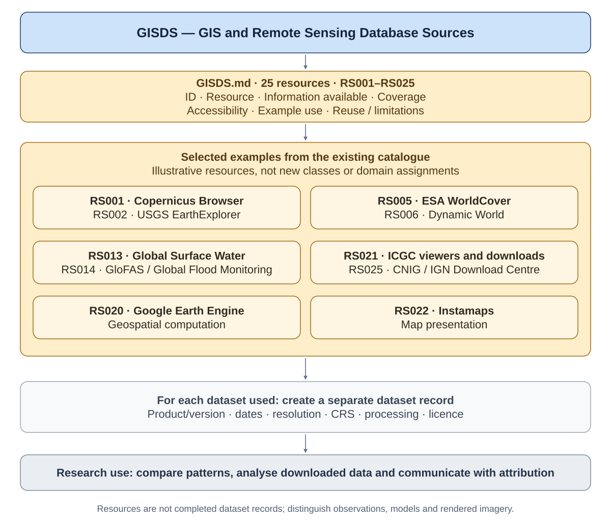

# Geographic Information and Data Sources (GISDS)

[View full-size diagram](assets/diagrams/gisds_overview.svg).

## Introduction

Geographic Information and Data Sources (GISDS) identifies and organises geographic, cartographic and Earth-observation resources for ecological research. It is an independently maintained catalogue within the Ecological Information federation of Ecological Interaction, supporting readers who need to find, view, analyse or reuse spatial information. Its purpose is to make sources, access routes and interpretation limits explicit before data are selected for a particular research question.

GISDS is a work-in-progress academic research resource. The catalogue describes providers, platforms and tools; it does not contain downloaded datasets or completed product-level records. Public access to a resource does not establish its suitability for every study or grant permission to reuse it.

## Research Scope

The catalogue covers satellite imagery, land cover and land use, environmental and ecological layers, water and marine information, hazards, settlements, airborne observations, terrain and cartography. It also includes geospatial computation and map-presentation tools. These resources differ in geographic coverage, observation periods, resolution, access conditions and reuse requirements.

Source selection requires distinctions between observations, derived classifications, modelled estimates and rendered imagery. A provider may host many products with different characteristics. Dataset-specific dates, resolution, coordinate reference systems, processing and licences therefore need to be recorded separately. Detailed metadata fields, interpretation cautions, review provenance and earlier document versions remain in the [research notes](RESEARCH_NOTES.md).

## Methodology and Federation

The Database Reference Methodology (DRM) provides the developing federation framework for identities, classifications, relationships and provenance. GISDS remains responsible for geographic source discovery; EII, the Ecological Indicator Inventory, catalogues indicators and qualified interpretations. Finding a geographic source does not itself establish an indicator or validate a measurement.

Shared metadata conventions can support future interoperability while preserving each catalogue’s definitions and evidence. The diagram expresses conceptual relationships and emerging uses, not a merged database or an implemented analytical pipeline. Source records remain independently maintained.

## Resource Catalogue

The [GISDS — Resource Catalogue](GISDS.md) contains 25 resources with stable identifiers RS001–RS025. Its seven columns describe each resource, the information available, coverage, accessibility, example use and reuse or limitations. Descriptions draw on provider documentation; interfaces and access conditions can change, and inclusion does not constitute end-to-end platform verification.

Research by Jonathan Minchin, Ecological Interaction ([ORCID](https://orcid.org/0000-0001-8152-1796)). See [citation metadata](CITATION.cff), [research and reuse notes](RESEARCH_NOTES.md) and the [changelog](CHANGELOG.md). No repository licence has been selected; third-party data retain their own reuse conditions.
